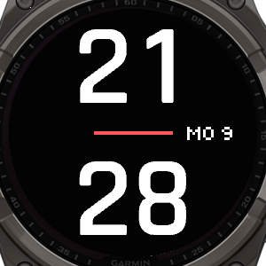
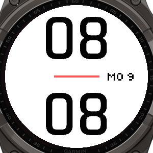
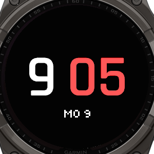
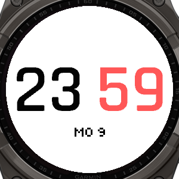

# Split Time

Esfera para relojes Garmin con pantalla MIP, con la hora en cifras grandes y un color destacado `#ff2d6f`. Tiene dos estilos, y la fecha usa los glifos pixelados de [Pixel Time](https://github.com/joxerg/PixelTime).

Diseñada y probada para **tactix 8 Solar 51 mm** / **fēnix 8 Solar 51 mm** (ID de Connect IQ: `fenix8solar51mm`).

| | Fondo negro | Fondo blanco |
|---|---|---|
| **A - Vertical** |  |  |
| **B - Horizontal** |  |  |

## Funciones

- **Estilo A - Vertical**: horas arriba y minutos abajo, separados por una línea `#ff2d6f`, con la fecha en el cuadrante derecho.
- **Estilo B - Horizontal**: `9 05` en una línea, con los minutos en `#ff2d6f` y la fecha debajo.
- **Cifras lo más grandes posible**: la esfera calcula el tamaño de la fuente Bionic del sistema para que la hora más ancha quepa dejando unos 10 px hasta el borde circular. El tamaño no cambia con la hora.
- **Color destacado** `#ff2d6f`. La pantalla MIP muestra 64 colores, así que el reloj usa el rosa-rojo más cercano.
- **Fecha pixelada**: `MO 12`, `TU 3`, `WE`, `TH`, `FR`, `SA`, `SU`.
- **Fondo negro o blanco**, con los colores invertidos. El color destacado se mantiene.
- **Calendario mensual**: mantén pulsada la pantalla para abrirlo. Con el calendario abierto, una pulsación larga a la izquierda muestra el mes anterior, a la derecha el siguiente y en el centro vuelve a la hora. El día actual aparece subrayado con el color de la línea.
- Respeta el formato de 12/24 h del reloj. En el estilo B la hora va siempre sin cero delante, como en la referencia.
- Bajo consumo: se refresca una vez por minuto y no usa imágenes.

## Instalación

1. Descarga `SplitTime.prg` desde la [última release](../../releases/latest).
2. Cierra Garmin Express y conecta el reloj por USB.
3. Copia el archivo en `GARMIN\APPS`.
4. Expulsa el reloj y desconéctalo.
5. Mantén pulsado **UP/MENU** sobre la esfera, entra en **Esfera** y elige **Split Time**.

## Ajustes

En el reloj: mantén pulsado **UP/MENU**, entra en **Esfera** y en **Personalizar**.

| Ajuste | Opciones |
|---|---|
| Estilo | A - Vertical (por defecto) / B - Horizontal |
| Fondo negro | Sí (por defecto) / No |

Como la esfera se instala a mano, estos ajustes no aparecen en la app Garmin Connect.

## Compilar desde el código

Necesitas el [Connect IQ SDK](https://developer.garmin.com/connect-iq/sdk/) con el dispositivo *fēnix 8 Solar 51mm*, y una clave de desarrollador.

```bash
monkeyc -f monkey.jungle -d fenix8solar51mm -o SplitTime.prg -y /ruta/a/developer_key
```

El margen con el borde, los huecos, el color y el bloque de la fecha se ajustan con las constantes del principio de [`source/SplitTimeView.mc`](source/SplitTimeView.mc).

## Licencia

[MIT](LICENSE)
